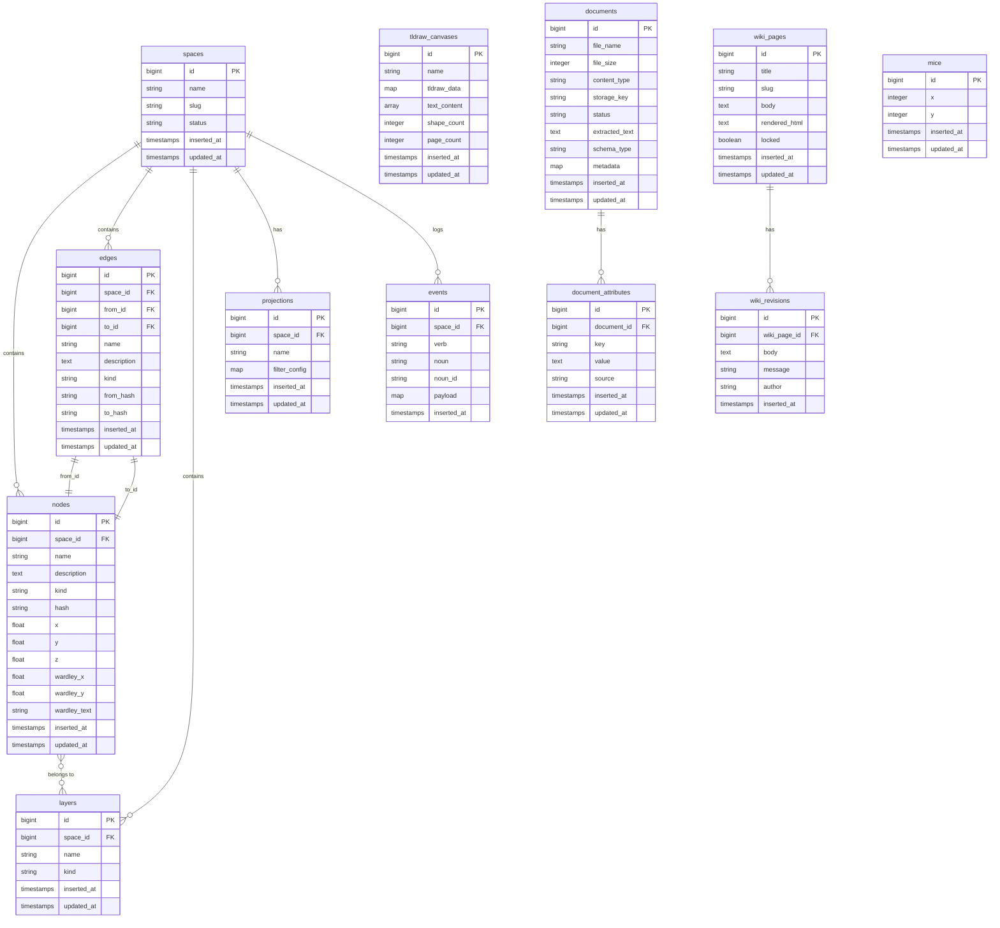

# Data Model

> Canonical entity definitions for Adaptics.
> Cross-references: [CONCEPT_INVENTORY.md](CONCEPT_INVENTORY.md) · [PERSONAS.md](PERSONAS.md)
>
> **Status legend**
> - `exists` — table in current schema
> - `rename` — table exists, rename planned
> - `planned` — not yet in schema

---

## ER Diagram

---

## Entity Reference

### Space `planned`
Top-level container for a concept map. All Nodes, Edges, Layers, Projections, and Events belong to a Space.

| Field | Type | Notes |
|---|---|---|
| name | string | Human-readable label |
| slug | string | URL-safe identifier |
| status | string | draft, published, archived |

**Planned migration:** `create_spaces`

---

### Node `exists` — table: `nodes`
The primary unit of content on a Space. In concept map terms, a Node is a **concept** — a perceived regularity in events or objects, labeled with a word or phrase. Currently lacks `space_id` — adding it is the first canvas migration.

| Field | Type | Notes |
|---|---|---|
| name | string | Concept label displayed on canvas |
| description | text | Optional longer description |
| kind | string | Node type (e.g. concept, question, resource, anchor, capability) |
| hash | string | Content hash for sync/dedup |
| x, y, z | float | Canvas position |
| wardley_x, wardley_y | float | Position in Wardley map projection |
| wardley_text | string | Wardley annotation |

**Planned migration:** add `space_id` FK to `nodes`

> **Concept map note:** Wardley maps, IVN graphs, process flows, and causal loop diagrams are all Projections over the same Node/Edge graph — differentiated by `kind`, axis mappings, and filter configs, not separate data models.

---

### Edge `rename` — table: `links` → `edges`
Directed relationship between two Nodes. In concept map terms, an Edge is the **linking phrase** — the labeled arc that turns two nodes into a readable proposition: `[Node A] → [linking phrase] → [Node B]`. The `name` field carries that phrase (e.g. "is essential for", "depends on", "produces").

| Field | Type | Notes |
|---|---|---|
| from_id | bigint FK | Source Node |
| to_id | bigint FK | Target Node |
| name | string | Linking phrase — readable proposition connector |
| description | text | Optional detail |
| kind | string | Edge type (e.g. causal, hierarchical, associative) |
| from_hash, to_hash | string | Content hashes for sync |

**Planned migration:** rename `links` → `edges`, add `space_id` FK, add `kind`

> **Concept map note:** A Wardley map edge is an Edge with `kind: "depends_on"`. A causal loop edge is `kind: "causal"`. The linking phrase (`name`) makes the proposition human-readable across all view types.

---

### Layer `planned` — table: `layers`
Named grouping of Nodes within a Space. Supports swimlane-style organization.

| Field | Type | Notes |
|---|---|---|
| name | string | Layer label |
| kind | string | E.g. role, time-phase, system |

---

### Projection `planned` — table: `projections`
A saved view configuration for a Space — filters, sorts, layout strategy.

| Field | Type | Notes |
|---|---|---|
| name | string | Projection label |
| filter_config | map | JSON filter/sort rules |

---

### Event `planned` — table: `events`
A typed record of a user or system action. Format: `verb:noun:id[:payload]`.

| Field | Type | Notes |
|---|---|---|
| verb | string | create, move, delete, hover, connect |
| noun | string | node, edge, space, projection |
| noun_id | string | ID of the affected entity |
| payload | map | Additional context (e.g. from/to coordinates) |

---

### Canvas `exists` — table: `tldraw_canvases`
Freeform tldraw drawing surface. Separate from the graph Space — used for `/draw`.

| Field | Type | Notes |
|---|---|---|
| name | string | Canvas label |
| tldraw_data | map | Raw tldraw JSON store |
| text_content | array | Extracted text strings from shapes |
| shape_count | integer | Total shape count |
| page_count | integer | Number of tldraw pages |

---

### Document `exists` — table: `documents`
An uploaded file (currently PDF) with a processing lifecycle.

| Field | Type | Notes |
|---|---|---|
| file_name | string | Original filename |
| file_size | integer | Bytes |
| content_type | string | MIME type |
| storage_key | string | Unique storage path |
| status | string | pending → uploaded → extracting → ready → error |
| extracted_text | text | Full text from pdftotext |
| schema_type | string | schema.org type annotation |
| metadata | map | Freeform JSON metadata |

---

### DocumentAttribute `exists` — table: `document_attributes`
Key-value annotation on a Document. `source` tracks provenance.

| Field | Type | Notes |
|---|---|---|
| key | string | Attribute name |
| value | text | Attribute value |
| source | string | manual, ner, geocoded, metadata_extractor |

Unique index on `(document_id, key, value)` — supports multi-value attributes.

---

### WikiPage `exists` — table: `wiki_pages`
A knowledge base article with Markdown body and revision history.

| Field | Type | Notes |
|---|---|---|
| title | string | Display title |
| slug | string | URL slug (unique) |
| body | text | Raw Markdown |
| rendered_html | text | Cached rendered output |
| locked | boolean | Prevents editing when true |

---

### WikiRevision `exists` — table: `wiki_revisions`
Point-in-time snapshot of a WikiPage body.

| Field | Type | Notes |
|---|---|---|
| body | text | Markdown body at time of save |
| message | string | Optional commit-style note |
| author | string | Who made the change |

---

### Mouse `exists` — table: `mice`
Real-time cursor telemetry for collaborative presence. Lightweight x/y tracking.

---

## Planned Migrations (in order)

| Priority | Migration | Unblocks |
|---|---|---|
| 1 | `create_spaces` | All node/edge scoping |
| 2 | `add_space_id_to_nodes` | Canvas isolation, multiplayer |
| 3 | `rename_links_to_edges` + `add_space_id_to_edges` | Vocabulary cleanup, edge scoping |
| 4 | `add_kind_to_edges` | Linking phrases, Wardley edge types |
| 5 | `create_layers` | Swimlane organization |
| 6 | `create_projections` | Saved view configurations |
| 7 | `create_events` | Audit log, collaborative presence |
