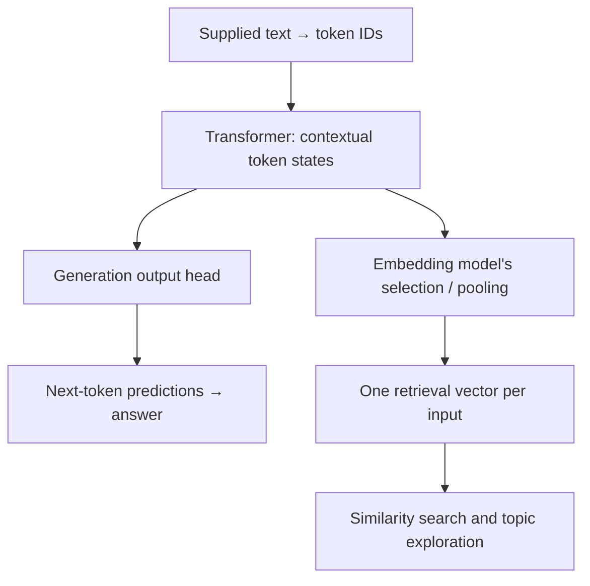

# Topic drift, multiple concepts, and what a transformer does

2026-11-01 · An explainer and a set of experiments for the transcript explorer.

Read the first half for the plain-language explanation, then the technical
section for the mechanics. The approaches near the end are proposals to test;
this document does not change the explorer's current embedding behavior.

**More text coverage is useful. The design question is how to preserve that
coverage while making each relevant detail easy to find.** A long conversation
can be useful context and contain several separately retrievable ideas.

## In plain language

### A conversation can change topics without anything going wrong

Imagine this development session. This is an invented example, not a quotation
from the private logs:

| Turn | Conversation | What it adds |
|---|---|---|
| 1 | “Officials' photos are missing on the people page.” | A production-image problem |
| 2 | “Keep the original uploads; make smaller versions for cards.” | A storage rule and display sizes |
| 3 | “The importer works locally but fails inside Docker.” | A deployment dependency |
| 4 | “The image service gets an unauthorized response.” | Authentication enters the image thread |
| 5 | “Separately, should user API tokens expire after an hour?” | A distinct authentication question |
| 6 | “For background imports, use a separate service credential.” | A distinction between two credential types |
| 7 | “Also, the navigation collapses badly on mobile.” | A new interface thread |
| 8 | “Okay, back to photos: apply the smaller version to cards.” | A return to the earlier thread |

This is a useful conversation, not a failed one. Some topics are connected by
causes and dependencies; others are side questions. A timeline with one topic
per contiguous block would miss the return to photos. A rule that assigns
every authentication message to one thread would merge different goals.

Three different problems can occur here:

1. **Conversation movement:** the human and assistant move between subjects.
   We want to represent that movement, including returns and dependencies.
2. **Constraint loss:** the assistant later recommends replacing original
   uploads, overlooking turn 2. That is a failure to preserve a requirement.
3. **Retrieval loss:** searching for token expiry fails to find turn 5 because
   it is represented only by a vector for a much larger image-heavy text.

The first is normal. The second concerns answering and instruction following.
The third concerns how we index and search the record. They need different
remedies.

### One short turn can already contain multiple concepts

Consider a single message:

> On the people page, use square avatars but keep the original uploads.
> Separately, expire user API tokens after an hour. Deploy the image change
> only after its tests pass; leave token expiry as a proposal for now.

That contains at least these pieces:

| Piece | Subject | Kind of statement |
|---|---|---|
| Square avatars | People-page appearance | Requested change |
| Preserve original uploads | Image storage | Constraint |
| One-hour user tokens | Authentication | Proposal |
| Image tests before deployment | Release workflow | Condition |
| Token expiry remains a proposal | Authentication | State / authorization boundary |

One embedding can represent useful aspects of the whole message. But “find the
storage constraint,” “what may be deployed?” and “was token expiry adopted?”
are different questions. Similarity alone cannot reliably distinguish a
proposal from an adopted decision or a condition from an accomplished action.

Splitting every sentence is not sufficient either. “Leave it as a proposal”
needs the preceding sentence to identify what “it” refers to. We need useful
pieces **with enough context to interpret them**.

### What the LLM is doing while it answers

In ordinary inference, the model's learned weights stay fixed. The changing
conversation supplies the current context. A surrounding application decides
which messages, instructions, tool results, or summaries to send on each call.
If that application removes or summarizes a passage, the model sees the
replacement, not the missing original.

At a high level, a transformer turns pieces of text into numerical
representations, lets those representations exchange information through
attention, and transforms them through multiple layers. A generative model
uses the result to predict successive output tokens. Different transformer
architectures support different tasks.
[Hugging Face's architecture explanation](https://huggingface.co/learn/llm-course/en/chapter1/4)
provides the background.

In our example, “unauthorized” can be interpreted using the image importer
context; “separately” can signal a shift; “back to photos” can point backward.
Those are examples of relationships the model may use. We cannot infer its
exact internal reasoning from the answer or from a similarity score.

The model does not automatically maintain an authoritative table of threads,
constraints, decisions, and completion states for our application. We can build
such a table, supply relevant portions when answering, and keep its evidence.

### What changes when we ask for an embedding

For retrieval, an embedding model produces a numerical representation of an
input. Our current endpoint returns one 4,096-number vector per input. We
compare those vectors to find related material.

Think of that vector as a learned search address. It is useful for locating
similar material, but it is not a transcript, a checklist, or a complete record
of which claim belongs to which speaker and time. It can carry several semantic
features without exposing them as separate fields.

If the address describes a conversation mostly about images, a smaller token
expiry discussion may be harder to retrieve through that one address. Giving
the expiry passage its own address gives the query another way to reach it.
This is a reason to test multiple representations; it is not a guarantee that
every long embedding loses its smaller topics.

### Why “more context” and “smaller retrieval units” can both help

More context can tell us that “those” means uploaded headshots and that “not
yet” concerns deployment. A smaller search unit can make the deployment
condition stand out.

For this explorer, we can preserve the complete conversation, index selected
passages with local context, and retrieve the larger original turn when a
passage matches. We can also retain broader representations for questions
about the whole project.

The goal is to make details findable without making them context-free.

## Technically: from tokens to answers or embeddings

### 1. Tokens and contextual hidden states

Tokenization maps text to a sequence of token IDs. Tokens may represent word
pieces or other text units; there is no fixed characters-to-tokens conversion.
Role markers and formatting can also consume tokens. A tokenizer's choices
matter for code, URLs, names, and multilingual text.
[Hugging Face's tokenizer material](https://huggingface.co/learn/llm-course/en/chapter6/1).

Write the sequence as `x_1, …, x_n`. The transformer maintains a hidden-state
matrix `H` with one row per token position and `d_model` features per row.
Position-dependent operations let it use ordering. A contextual state for
“token” in a credentials discussion can differ from its state in a discussion
of language-model tokenization. This is a contextual representation, not a
lookup of one permanent meaning for the word.

### 2. Attention and layers

For one attention head, a simplified formulation is:

```text
Q = H W_Q       K = H W_K       V = H W_V

A = softmax(Q Kᵀ / √d_k + M)
O = A V
```

`Q`, `K`, and `V` are learned projections. Each row of `A` weights permitted
positions; `O` combines their value vectors. In causal attention, `M` masks
future positions. Multiple heads, feed-forward transformations, residual paths,
and normalization compose the layers. Exact details vary by model.
[Attention Is All You Need](https://arxiv.org/html/1706.03762v7).

Attention heads are not a set of labeled topic folders. These transformations
can represent relationships without providing a durable thread assignment.
Nor does a large attention weight, by itself, establish why an answer was made.

### 3. Generation and the KV cache

A decoder language model turns a final contextual state into next-token
logits, then a probability distribution. A decoding policy selects a token and
generation continues. Schematically:

```text
p(next token | supplied context) = softmax(W_out h_last + b)
```

A KV cache retains keys and values for earlier token positions, per layer,
so subsequent generation can reuse them. It is not one pooled conversation
embedding and is not our on-disk vector cache.
[Transformers KV-cache documentation](https://huggingface.co/docs/transformers/main/en/cache_explanation).

If an application compacts or removes context, that is a separate operation.
A summary can omit an important constraint before inference even begins.
Conversely, a requirement may still be in the supplied tokens and nevertheless
be used incorrectly.

Long-context studies have found sensitivity to where relevant information
appears, including weaker retrieval from the middle of a context in tested
models. That is evidence to test placement and distractors, not a universal
law that every present-day model forgets the middle.
[Lost in the Middle](https://arxiv.org/abs/2307.03172).

### 4. Embedding extraction is a different output path

An embedding system selects or pools contextual states into a retrieval
representation, often normalizing it:

```text
z = normalize(pool(H_final))
```

The pooling operation depends on the model. Qwen3 Embedding uses causal
attention and the final-layer state of an appended end-of-sequence token.
Its training includes a contrastive objective that rewards relevant
query/document matching. That does not train an explicit field for every
decision or condition in our transcripts.
[Qwen3 Embedding paper](https://arxiv.org/html/2506.05176v3).

The final token's state is contextual: this is not merely embedding the last
word. It is also not necessarily an arithmetic average of token vectors. The
official usage example demonstrates last-token pooling and normalization.
[Qwen3-Embedding-8B model card](https://huggingface.co/Qwen/Qwen3-Embedding-8B).

The internal token-state matrix and the single vector returned to our app are
different objects:



These are conceptual output paths, not a claim that our application invokes
both outputs in one model call.

## Where topic blur can enter

There are several separate losses to inspect:

| Stage | What can be lost or mismatched | How to investigate |
|---|---|---|
| Input selection | A qualification falls after our current cutoff | Place relevant material after character 2,000 |
| Context assembly | “It” is separated from its referent | Compare isolated and context-enriched passages |
| Single-vector representation | A small subject does not strongly affect whole-text similarity | Compare whole-text and passage rankings |
| Retrieval objective | General relatedness differs from evidence for a specific question | Compare query instructions and reranking |
| State interpretation | Proposal, negation, condition, or later reversal is misread | Inspect full turns and later evidence |
| Visualization | A 3D projection obscures separation in 4,096 dimensions | Compare projected neighbors with full-vector rankings |

A model can accept a long input without making every detail equally easy to
retrieve from its resulting vector. Increasing vector dimension alone does not
make our ranking inspect each clause independently.

### A deliberately simplified numerical example

Suppose two unrelated concepts have perpendicular unit vectors:

```text
images:       a = (1, 0)
token expiry: b = (0, 1)
```

Imagine representing a mostly-images text with a weighted blend:

```text
z = normalize(0.9 a + 0.1 b)
  ≈ (0.994, 0.110)

cosine(b, z) ≈ 0.110
cosine(b, b) = 1
```

The separate expiry representation is easier for an expiry query to match.
This is a toy geometric illustration, **not Qwen's pooling algorithm, a measured
result, or a claim that the weights equal word-count proportions**. Actual
embeddings are nonlinear and can encode combinations of concepts. The example
shows why one query-independent score for a mixed representation can be a poor
substitute for inspecting the matching part.

A full-input vector may still outperform fragments for a coherent explanation
whose meaning depends on several paragraphs. We need both kinds of examples
in the evaluation.

## Approaches we can try

The question is broader than choosing a chunk size. These approaches address
different stages and can be combined.

| Approach | What it preserves or improves | Cost / limitation |
|---|---|---|
| Longer whole-prompt inputs | Later qualifications and broad context | One score still describes the whole input |
| Structural, overlapping chunks | Local details and some boundary context | More vectors; overlap does not resolve every reference |
| Small passages with surrounding context | Local focus plus antecedents | Context can itself introduce distraction |
| Concept or proposition records | Separate asks, decisions, constraints, and conditions | Extraction can invent or distort meaning |
| A hierarchy of passage, turn, thread, and project representations | Several levels of search and navigation | Summaries and groupings need provenance and maintenance |
| Query decomposition and hybrid retrieval | Different parts of a question; exact names and paths | Can retrieve disconnected evidence that needs checking |
| Joint query/passage reranking | Query-specific relevance judgments | Extra inference; cannot rank material never retrieved |
| Late chunking | Passage vectors informed by a broader context | Requires suitable token states, pooling, and backend support |
| ColBERT-style late interaction | Several matching signals per passage | A different representation, model, and indexing path |
| Explicit temporal and dependency links | Decisions, reversals, waiting states, and thread returns | Requires extraction or review beyond cosine similarity |

### A. Structural chunks and contextual passages

Use paragraphs, lists, role boundaries, or explicit “separately” clauses as
candidate boundaries, bounded by token limits. Do not require one vector per
human turn: the example prompt can produce several candidates that share a
parent turn.

Compare these representations of a small follow-up:

```text
Original: “Not yet; keep the originals.”

Context supplied with it:
Project: jurisdictional
Previous exchange: proposal to replace uploaded images after generating thumbnails
Current message: “Not yet; keep the originals.”
```

That context is useful if it is supported by the actual preceding exchange.
Try mechanically including a short source window before generating explanatory
prefixes. If a model writes a prefix, keep it as derived text with its sources,
not a replacement quotation.

Search the passage, then expand to the source turn and relevant neighbors for
reading. Separately test whether the prefix belongs in the embedding input,
reranker input, or only in the final reader.

### B. Extract several concepts from one turn

Create source-backed records such as:

```text
kind: constraint
subject: uploaded official images
statement: retain the original upload
source: session / turn / character span

kind: proposal
subject: user API tokens
statement: expire after one hour
adoption: explicitly deferred in this turn
source: session / turn / character span
```

The [Dense X Retrieval paper](https://arxiv.org/abs/2312.06648) explores retrieval
using concise, self-contained propositions. For our logs, extending that idea
to asks and decisions is a hypothesis to test, not a result established by the
paper. Preserve conditions, negation, speaker, and time. “Deploy after tests
pass” must not become “Deployment completed.”

Keep original passages searchable alongside extracted records. Extraction
mistakes should not remove the only path to the evidence.

### C. Keep representations at several scales

For “what were our main image concerns?”, a thread summary could be a better
entry point than one narrow passage. For “which turn required retaining the
originals?”, the passage is the better destination.

Index both levels and permit direct leaf retrieval; a broad summary should not
be the only gate through which a small topic is discoverable. The
[RAPTOR paper](https://arxiv.org/abs/2401.18059) is one research example of
retrieval across recursively summarized levels. We can start more simply with
source passages plus reviewed thread summaries.

Avoid collapsing all child vectors into one centroid as the sole search
representation. That can reintroduce the mixture problem. A centroid may still
be useful as an overview marker in the atlas.

### D. Decompose questions, retrieve broadly, then rerank

For “Did we preserve originals and deploy avatars after tests passed?”, search
for the storage constraint, image deployment, and verification evidence. Include
keyword retrieval for exact commands, IDs, and file paths. Keep the original
question so decomposition does not change its meaning.

A cross-encoder-style reranker evaluates a query and candidate passage jointly,
allowing query-specific interactions that a precomputed single-vector cosine
score cannot provide. Apply it to a limited candidate set. It adds inference
cost and cannot recover a passage absent from that set.
[Sentence Transformers' cross-encoder explanation](https://www.sbert.net/examples/cross_encoder/applications/README.html).

Then assemble the source turns and temporal context. Reranking is not proof of
completion, correctness, or absence of contradictory evidence.

### E. Late chunking: split after contextual encoding

The published late-chunking approach runs a longer text through the transformer,
then mean-pools token states within selected spans. This lets passage vectors
retain information from the broader input rather than encoding isolated pieces.
[Late Chunking](https://arxiv.org/html/2409.04701v3).

```text
Ordinary chunking: text → split → encode each piece → piece vectors
Late chunking:     text → contextual token states → pool spans → piece vectors
```

This is not a setting we can switch on in our current one-vector Ollama adapter.
We would need suitable token-level output and pooling support. Our Qwen model
uses causal attention and last-token extraction; the paper's mean-pooling
recipe should not be transplanted unchanged. In a causal model an early token
state cannot incorporate later text, which matters for references resolved
afterward. Assess model compatibility and retrieval quality before investing
in a backend change.

### F. Late interaction: retain multiple vectors

ColBERT keeps contextual token representations for queries and passages, then
matches them at query time. A simplified scoring form is:

```text
score(query, passage) = Σ_i max_j dot(q_i, passage_j)
```

Each query token can find a strong matching passage token instead of relying
on a single whole-passage vector. This differs from late chunking: it changes
both what is retained and how relevance is scored.
[ColBERT](https://arxiv.org/html/2004.12832v2).

This is a larger experiment involving a suitable trained model and multi-vector
index. Arbitrary hidden states from Qwen are not automatically a trained ColBERT
retriever. It may be worth testing if simpler representations still miss local
details; it is not a prerequisite for a useful next iteration.

### G. Represent thread relationships explicitly

Some questions are about relationships, not just subjects:

- A credential failure **blocks** the photo import.
- The token-expiry proposal is **separate from** the import credential.
- A later decision **supersedes** the earlier one.
- “Back to photos” **resumes** an earlier thread.

Store reviewed or source-backed links with timestamps. Similarity can suggest
connections but should not decide those relations by itself. In the UI, allow
one turn to contribute to several threads with different roles.

For live answering, a compact, cited register of active constraints and decisions
could help keep the original-upload rule available through unrelated exchanges.
That is application-managed context, separate from the transformer's KV cache.

## What I would test next in Adaptics

Use the existing explorer to compare representations rather than selecting a
large new architecture immediately:

1. Preserve full source text and role information. Separate reader previews
   from embedding input preparation; the current 2,000-character slice affects
   both the vector input and the atlas's source-text record.
2. Keep the current capped prompt vector as a baseline. Compare longer prompts
   with structural token-bounded chunks, then add a small amount of source
   context. Test several sizes instead of assuming the model's maximum window
   is the best retrieval unit.
3. Retrieve chunks but deduplicate and rank parent turns. Keep offsets so the
   reader can highlight the matching passage. Large turns should not fill every
   result slot merely because they produced more chunks.
4. Add assistant-answer representations for outcome questions. Keep human intent,
   assistant claims, observed tool evidence, and user acceptance distinguishable.
5. Trial extracted concepts and reranking on a small reviewed set. Consider late
   chunking or late interaction if the simpler approaches leave clear failures.
6. Version input recipes and caches so changed chunking or instructions cannot
   silently reuse incompatible vectors. Keep raw and cleaned text separately.

An illustrative parent-turn retrieval score is the best matching child score,
followed by diversity selection and optional reranking. It is not automatically
fair to longer turns: more chunks give more opportunities for a high score.
Measure that bias and compare alternatives rather than simply summing hits.

### Evaluation cases

| Case | What a useful system should do |
|---|---|
| Long coherent explanation | Retain enough context to understand the whole argument |
| Late qualification beyond character 2,000 | Find and cite it |
| Small topic inside a large unrelated discussion | Retrieve the small topic without relying on a broad summary |
| Two concepts in one short turn | Find either, with the correct parent context |
| “Those images” / “not yet” follow-up | Resolve references using supported nearby context |
| Proposal followed by rejection | Keep both events; don't report adoption |
| Earlier rule followed by an unrelated detour | Preserve the rule when it becomes relevant again |
| Rewind or repeated prompt | Avoid treating copies as independent corroboration |
| URL or file-name overlap without shared intent | Avoid ranking by those references alone |

Judge evidence recall, correctness of citations and interpretation, unrelated
results, and query/indexing cost. For unknown answers, check whether the system
can say what it searched without claiming the work never happened. More
elaborate extraction must earn its cost against the simpler baselines.

### Consequences for the atlas

Adding passages need not mean plotting every fragment by default. Use thread
or turn markers for an overview, expand a selected marker into passages, and
show matching spans in the reader. Retain multi-thread membership rather than
forcing one categorical label per turn. A 3D projection remains a navigational
aid; evidence ranking should use the underlying representations.

More vectors also affect performance. The [current PCA implementation](lib/adaptics/semantic/topics.ex) constructs
a pairwise Gram matrix, with roughly `O(n² d)` work for that step; k-means also
grows with the vector count. Ten times as many points can make that pairwise
step roughly one hundred times larger. Keep detailed retrieval units separate
from the set projected for the overview, and cache both appropriately.

## The 2K / 32K distinction in this project

| Quantity | Meaning |
|---|---|
| 2,000 characters | Our current application slice of each human prompt |
| 32K tokens | The model's published input-context capacity |
| 4,096 dimensions | Numbers in each returned retrieval vector |
| Multiple vectors | Several retrieval representations for one source, such as passage vectors |

The published model capacity and dimensionality are documented in the
[Qwen model card](https://huggingface.co/Qwen/Qwen3-Embedding-8B). Our local
Ollama metadata previously reported a context length of 40,960, so effective
server limits and overflow behavior still need verification before raising
limits. A metadata value does not establish that still larger inputs are safe
or equally effective.

Preserve more text, give useful pieces their own retrieval paths, and retain
the context and evidence needed to interpret each piece. We can experiment
with that combination without discarding the existing whole-turn view.

Related: [brainstorm](TRANSCRIPT_EXPLORER_IDEAS.md),
[current explorer](TRANSCRIPT_EXPLORER.md), and
[continuation handoff](docs/archive/TRANSCRIPT_EXPLORER_HANDOFF.md).
